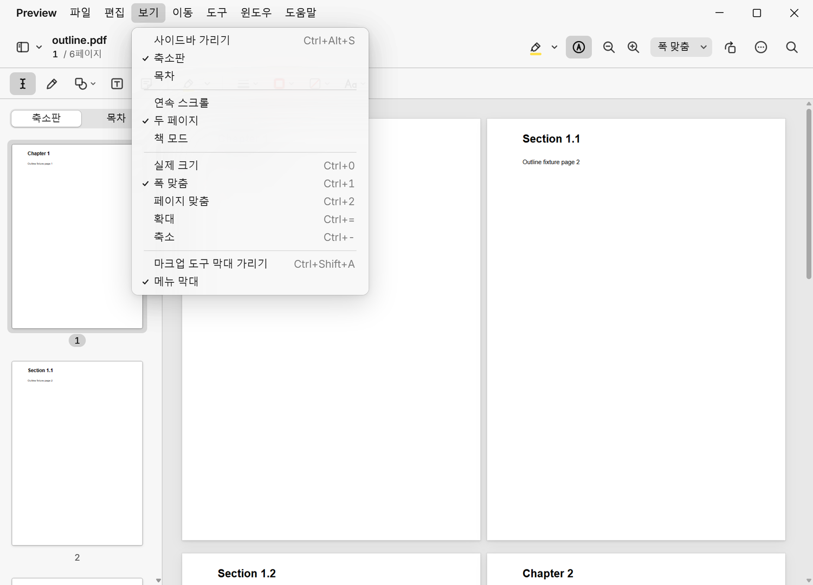
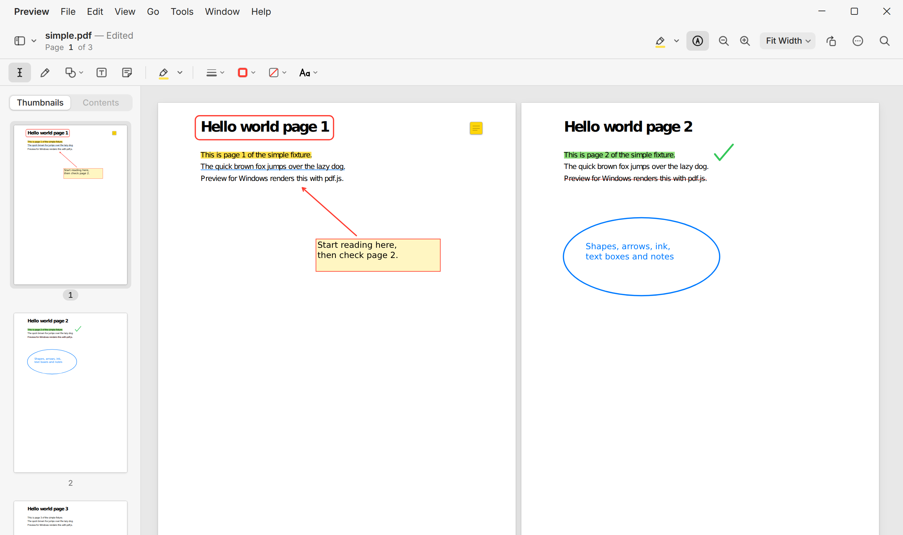
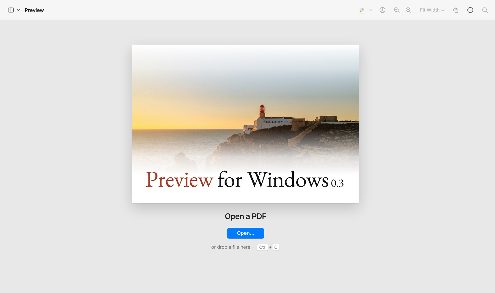

# Preview for Windows

[English](README.md) · **한국어**

macOS 미리보기처럼 빠르고 깔끔한 Windows용 PDF 뷰어·편집기입니다. 바로 열리는 창,
제목 표시줄과 하나로 이어진 도구 막대, 연속 스크롤과 두 페이지 보기, 찾기, 페이지를
재배치·삭제·복사·붙여넣기·병합하는 축소판 사이드바, 그리고 미리보기의 마크업
도구(하이라이트, 밑줄, 취소선, 도형, 화살표, 그리기, 텍스트 상자, 메모)를 갖추었고,
마크업은 표준 PDF 주석으로 저장됩니다.



**버전 0.5.1** · 영어와 한국어 · Windows 10·11, x64 · 설치 없이 쓰는 `Preview.exe`(약 7MB)
또는 사용자별 설치 프로그램(약 4.6MB) · 네트워크 연결 없음, 원격 분석 없음 · GNU AGPL v3

**[최신 버전 다운로드](https://github.com/gobad820/Preview_For_Windows/releases/latest)**

## 목차

- [하는 일](#하는-일)
- [키보드 단축키](#키보드-단축키)
- [설치](#설치)
- [기술 스택](#기술-스택)
- [빌드](#빌드)
- [개발](#개발)
- [프로젝트 구조](#프로젝트-구조)
- [버전 기록](#버전-기록)
- [라이선스](#라이선스)
- [아직 지원하지 않는 것](#아직-지원하지-않는-것)

## 하는 일

**열기와 보기**

- 더블클릭이나 "연결 프로그램"(설치 프로그램이 `.pdf`를 등록합니다), 도구 막대,
  `Ctrl+O`, 또는 창에 파일을 끌어다 놓아 PDF를 엽니다.
- 문서 전체를 처리하기 전에 첫 페이지부터 그립니다. 화면 근처의 페이지만 그려 두기
  때문에 300페이지 파일도 3페이지 파일처럼 스크롤됩니다.
- 연속 스크롤 또는 두 페이지 보기(사이드바 버튼 옆 화살표의 보기 메뉴)를 고를 수 있고,
  책 모드에서는 첫 페이지를 표지처럼 오른쪽에 따로 놓습니다. 폭 맞춤과 페이지 맞춤은
  펼친 두 페이지 전체에 맞추고, `→` / `←`는 두 페이지씩 넘깁니다.
- 확대/축소: 폭 맞춤, 페이지 맞춤, 미리 정한 배율, `Ctrl` + 마우스 휠이나 트랙패드
  핀치, 키보드. 확대/축소해도 커서 아래 지점은 그 자리에 머뭅니다.
- 페이지 축소판과 문서 목차(책갈피)가 있는 사이드바.
- 강조 표시와 다음/이전 이동이 되는 문서 내 찾기, 텍스트 선택과 복사, 회전, 고해상도
  화면에서도 선명한 렌더링.
- 파일마다 마지막 페이지·확대 비율·회전을, 그리고 창 크기와 페이지 배치를 기억합니다.

**페이지 편집**, 미리보기의 사이드바처럼

- 축소판을 선택하고(클릭, `Ctrl`+클릭, `Shift`+클릭, 화살표, `Ctrl+A`) 하나 또는 여러
  개를 끌어 순서를 바꾸고, 페이지를 삭제·복사·오려두기·붙여넣기 할 수 있으며 모든
  변경은 실행 취소·실행 복귀가 됩니다.
- 병합: 탐색기에서 PDF 파일을 두 축소판 사이에 끌어다 놓거나 ⋯ › 파일에서 페이지
  삽입…을 씁니다. 암호가 걸린 파일은 암호를 묻고, 소유자 암호로 제한만 걸린 파일은
  암호 없이 열고 저장합니다. 한 Preview 창에서 복사한 페이지를 다른 창에 붙여넣을 수
  있고, 탐색기에서 복사한 PDF도 페이지로 붙여넣어집니다.
- 저장: `Ctrl+S`는 원래 파일에 덮어씁니다(원자적으로, 바뀐 내용이 있을 때만).
  `Ctrl+Shift+S`는 사본을 저장하고 그 사본을 계속 편집합니다. 연 뒤에 다른 프로그램이
  파일을 바꿨다면 덮어쓰기 전에 묻습니다. 저장하지 않은 변경이 있으면 제목에
  "— 편집됨"이 붙고, 문서를 닫거나 바꾸기 전에 묻습니다. 저장한 파일은 목차와
  메타데이터를 유지하고, 내부 링크는 옮긴 페이지를 따라가며, 삭제한 페이지는 파일에
  흔적을 남기지 않습니다.

**마크업**, 미리보기의 마크업 도구 막대처럼(펜 끝 모양 버튼 또는 `Ctrl+Shift+A`)

- 선택한 텍스트에 하이라이트(다섯 가지 색), 밑줄, 취소선을 긋습니다. 도구 막대의
  하이라이트 버튼은 하이라이트 모드를 켜고 끄며, 켜져 있으면 선택을 마칠 때마다
  표시됩니다. 텍스트를 선택한 채로 누르면 그 선택을 표시합니다.
- 사각형, 둥근 사각형, 타원, 선, 화살표(끌어서 그리거나 클릭하면 기본 크기,
  `Shift`를 누르면 정사각형·원·45° 선), 자유 그리기, 텍스트 상자(한글 포함), 메모.
- 주석을 클릭해 선택하고, 끌어서 옮기고, 손잡이를 끌어 크기를 바꾸고, 화살표 키로
  조금씩 움직이고, `Delete`로 지우고, `Ctrl+D`로 복제합니다. 선 두께, 테두리 색, 채우기,
  텍스트 스타일은 선택한 주석에 적용되고 이후의 기본값이 됩니다. 모든 변경은 실행
  취소할 수 있습니다.
- 페이지를 옮기거나 복사하거나 다른 창에 붙여넣거나 병합해도 주석이 페이지를 따라가며,
  축소판에도 보입니다.
- 모양 스트림(appearance stream)이 있는 표준 주석으로 저장하므로 Acrobat, Edge,
  Chrome, Mac 미리보기에서도 여기서 그린 그대로 보입니다. 텍스트 상자에는 쓰인 맑은
  고딕 글자만 넣습니다. 이 앱으로 저장한 파일을 다시 열면 주석을 다시 편집할 수 있고,
  다른 앱이 만든 주석은 보여 주고 보존하지만 편집하지는 않습니다.

**메뉴 막대와 설정**

- 창 안의 메뉴 막대(Preview, 파일, 편집, 보기, 이동, 도구, 윈도우, 도움말)는 macOS
  제목 표시줄처럼 도구 막대와 이어져 있고 앱의 모든 기능이 들어 있습니다. 메뉴 막대가
  곧 창의 제목 표시줄이라 최소화·최대화·닫기 버튼이 그 오른쪽 위 모서리에 있습니다
  (메뉴 막대를 숨기면 도구 막대의 모서리로 갑니다). Mac처럼 제목을 클릭한 뒤 옆
  제목으로 미끄러지듯 옮겨 가거나, Windows처럼 키보드로 쓸 수 있습니다. `Alt`나
  `F10`으로 메뉴 막대에 가고, `Alt`+밑줄 글자로 메뉴를 열고, 화살표로 움직이고,
  `Enter`로 실행합니다. 보기 › 메뉴 막대로 숨길 수 있고, 숨겨도 `Alt`로 다시 불러옵니다.
  도움말 › 키보드 단축키에서 모든 단축키를 볼 수 있습니다.
- 설정…(`Ctrl+,`)은 일반·마크업·윈도우 탭이 있는 macOS식 설정 창을 엽니다. 새 파일의
  기본 확대/축소, 페이지 배치와 책 모드, 문서를 열 때 사이드바 보기, 파일별 위치
  기억, 기본 하이라이트 색·도형 색·선 두께·텍스트 크기, 메뉴 막대 보기를 정할 수 있고,
  바꾼 값은 바로 적용됩니다.
- 둘 다 창의 나머지처럼 밝은 테마와 어두운 테마를 따릅니다.

**영어와 한국어**

- 설정 › 일반 › 언어: 자동(Windows 표시 언어를 따름), English, 한국어. 메뉴, 도구 막대,
  마크업 도구, 알림, 오류 메시지, 열기·저장 대화상자, 설정 창까지 화면 전체가 다시
  시작하거나 문서를 닫지 않고 바로 바뀝니다.
- 한국어는 macOS 미리보기 한국어판의 용어(파일, 편집, 보기, 축소판, 폭 맞춤,
  하이라이트 등)를 따르고, 한국어 Windows처럼 `Alt`를 누르고 있는 동안 메뉴 접근 키를
  파일(F)처럼 보여 줍니다.

<picture>
  <source media="(prefers-color-scheme: dark)" srcset="docs/screenshot-dark.png">
  
</picture>

**Mac 앱 같은 모습**

- 52px로 하나로 이어진 제목 표시줄과 도구 막대, Windows 11의 Mica 배경, Inter 글꼴,
  SF 스타일 아이콘, Mac식 메뉴와 알림, Windows를 따르는 밝은·어두운 테마.
- 빈 창에는 시작 화면이 나오고, ⋯ › Preview에 관하여에서 버전을 볼 수 있습니다.

<picture>
  <source media="(prefers-color-scheme: dark)" srcset="docs/empty-window-dark.jpg">
  
</picture>

암호가 걸린 파일이나 PDF가 아닌 파일은 빈 창 대신 창 안에 오류를 보여 줍니다.

## 키보드 단축키

| 동작 | 키 |
| --- | --- |
| 열기 | `Ctrl+O` |
| 설정 | `Ctrl+,` |
| 메뉴 막대: 이동 / 메뉴 열기 | `Alt` 또는 `F10` / `Alt`+밑줄 글자 |
| 찾기 / 찾기 닫기 | `Ctrl+F` / `Esc` |
| 다음 / 이전 결과 (찾기 입력란에서) | `Enter` / `Shift+Enter` |
| 확대 / 축소 / 100% | `Ctrl+=` / `Ctrl+-` / `Ctrl+0` |
| 폭 맞춤 / 페이지 맞춤 | `Ctrl+1` / `Ctrl+2` |
| 오른쪽으로 / 왼쪽으로 회전 | `Ctrl+L` / `Ctrl+Shift+L` |
| 사이드바 보기·가리기 | `Ctrl+Alt+S` |
| 마크업 도구 막대 보기·가리기 | `Ctrl+Shift+A` |
| 선택한 주석 삭제 / 복제 | `Delete` / `Ctrl+D` |
| 선택한 주석을 1pt / 10pt씩 이동 | 화살표 / `Shift`+화살표 |
| 텍스트 편집 끝내기, 도구 해제, 선택 해제 | `Esc` |
| 저장 / 다른 이름으로 저장 | `Ctrl+S` / `Ctrl+Shift+S` |
| 실행 취소 / 실행 복귀 | `Ctrl+Z` / `Ctrl+Y`, `Ctrl+Shift+Z` |
| 윈도우 닫기 | `Ctrl+W` |
| 페이지 선택 (사이드바) | 클릭, `Ctrl`+클릭, `Shift`+클릭, `↑` `↓`, `Ctrl+A` |
| 페이지 복사 / 오려두기 / 붙여넣기 | `Ctrl+C` / `Ctrl+X` / `Ctrl+V` (사이드바에서) |
| 페이지 삭제 | `Delete` 또는 `Backspace` (사이드바에서) |
| 페이지로 이동 | `Ctrl+G` |
| 다음 / 이전 페이지 (두 페이지 보기에서는 두 쪽씩) | `→` / `←` |
| 한 화면 아래로 / 위로 | `Space`, `PageDown` / `Shift+Space`, `PageUp` |
| 첫 페이지 / 마지막 페이지 | `Home` / `End` |

## 설치

[Releases](https://github.com/gobad820/Preview_For_Windows/releases/latest)에서 받습니다.

- `Preview_<버전>_x64-setup.exe`: 사용자별 설치 프로그램(관리자 권한 필요 없음). 시작
  메뉴에 항목을 추가하고 `.pdf` 파일을 Preview로 열지 묻습니다.
- `Preview-<버전>-portable.exe`: 설치 없이 아무 곳에서나 실행합니다.

둘 다 WebView2 런타임이 필요하며, 최신 Windows 10·11에는 이미 들어 있습니다.
`SHA256SUMS.txt`에 파일 체크섬이 있습니다.

코드 서명이 없어서 처음 실행할 때 Windows SmartScreen이 "Windows의 PC 보호"
경고를 띄울 수 있습니다. **추가 정보 › 실행**을 누르세요.

## 기술 스택

| 부분 | 기술 |
| --- | --- |
| 네이티브 셸 | Rust 1.99와 [Tauri 2](https://tauri.app) (대화상자·창 상태 플러그인, clipboard-win) |
| 웹 뷰 | Windows에 기본으로 들어 있는 Microsoft Edge WebView2 |
| UI | TypeScript 7, 프레임워크 없이 순수 DOM, Vite 8, 글꼴은 Inter |
| PDF 읽기 | [pdf.js](https://mozilla.github.io/pdf.js/) 6.4 (`pdfjs-dist`), 오프라인용 리소스 포함 |
| PDF 쓰기 | `@cantoo/pdf-lib` 2.11과 `@cantoo/fontkit` 2.0 (맑은 고딕 부분 집합) |
| 빌드 | Linux/WSL2에서 cargo-xwin, clang-cl, lld-link로 교차 컴파일, NSIS 설치 프로그램 |
| 테스트 | Vitest 5 (단위 테스트 526개), Playwright 1.64 (E2E 테스트 291개), 저장 파일의 PDFium 검사, 실제 exe의 WebView2 DevTools 검사 |

버전, 라이선스, 각 기술을 고른 이유, 테스트 구성은
[docs/tech-stack.md](docs/tech-stack.md)(영어)에 있습니다.

## 빌드

앱은 전부 Linux(WSL2도 됨)에서 `x86_64-pc-windows-msvc`로 교차 컴파일해 만듭니다.
Windows에는 아무것도 설치할 필요가 없습니다.

필요한 것(모두 사용자 공간에 설치):

- Node 20 이상과 `npm ci`
- Rust(rustup)와 `rustup target add x86_64-pc-windows-msvc`
- `cargo install cargo-xwin` (처음 쓸 때 MSVC CRT와 Windows SDK를 내려받음)
- `PATH`에 `clang-cl`, `lld-link`, `llvm-lib`, `llvm-rc`, `makensis`
  (예: conda-forge에서 `mamba create -n winbuild -c conda-forge clang lld llvm-tools nsis`)

그다음:

```bash
scripts/build-windows.sh            # 실행 파일만
scripts/build-windows.sh --bundle   # 실행 파일 + NSIS 설치 프로그램
```

결과물은 `src-tauri/target/x86_64-pc-windows-msvc/release/`에 생깁니다.
`scripts/build-windows.sh`는 개발에 쓴 conda 환경의 `PATH`를 지정하므로, 도구가 다른
곳에 있다면 `export` 두 줄을 고치세요.

## 개발

```bash
npm run dev        # 브라우저 플랫폼 shim으로 Vite 개발 서버 실행 (?file=fixtures/simple.pdf)
npm test           # Vitest 단위 테스트
npm run e2e        # 헤드리스 Chromium에서 Playwright E2E 테스트 (빌드 + 미리보기 서버)
npx tsc --noEmit   # 타입 검사
```

브라우저 shim에서는 `/?file=fixtures/<이름>.pdf`로 테스트 파일을 엽니다.
`tests/fixtures`의 파일은 `scripts/make-fixtures.py`(reportlab)로 만들며, 크기가 섞인
페이지, 300페이지 파일, 목차, 링크, 암호화된 파일과 깨진 파일, 회전된 페이지, 다른 앱이
만든 주석, 글꼴을 넣은 한글 문서와 넣지 않은 한글 문서가 있습니다.

Playwright는 `PW_PORT`(기본 4173)에 자체 미리보기 서버를 띄웁니다. 테스트를 동시에
돌리는 체크아웃마다 포트를 따로 주세요. 예: `PW_PORT=4411 npx playwright test`.

### Windows에서 실제 앱 다루기

`scripts/cdp-windows.ps1`은 WebView2 DevTools 포트를 루프백에 열어 `Preview.exe`를
실행하고(별도 WebView2 프로필을 쓰므로 이미 열어 둔 Preview 창에는 영향이 없습니다),
앱 안에서 JavaScript 단계를 실행해 결과를 JSON으로 출력합니다. 데스크톱을 클릭하거나
키를 입력하지 않으므로 컴퓨터를 쓰는 사람을 방해하지 않습니다. 저장, 병합, 마크업을
실제 파일로 이렇게 확인했습니다.

WSL에서 `scripts/smoke-windows.sh tests/fixtures/simple.pdf`를 실행하면 exe를
`C:\Users\Public\pfw-smoke`에 복사하고, 파일과 함께 실행해 창을 `shot.png`로 찍은 뒤
닫습니다. 창에 포커스를 주지 않습니다.

### 저장한 주석을 다른 뷰어로 확인하기

`scripts/pdfium-render.py FILE PAGE SCALE --png out.png [--probe X,Y ...]`는 Chrome과
Edge의 엔진인 PDFium으로 주석의 모양 스트림을 그려 페이지를 렌더링합니다
(`pypdfium2` 필요). 쓰기 테스트는 이것으로 저장한 사각형이 그린 자리에 있는지,
`/Rotate` 페이지에서도 맞는지 확인합니다.

### 앱 아이콘과 시작 화면

앱 아이콘은 `src-tauri/icons/source/logo.png`의 로고 그림(해변 위의 파란 필터 링)입니다.
`python scripts/make-icons.py`가 렌즈 부분을 잘라 모서리를 둥글게 하고 모든 아이콘
파일을 만듭니다(Pillow 필요).

빈 창과 Preview에 관하여의 시작 화면은 `src/assets/splash.jpg`이며,
`node scripts/make-splash.mjs`가 `scripts/splash/splash.html`에서 그립니다. 그림에는
`package.json`의 주·부 버전이 들어가므로 부 버전을 올린 뒤에는 다시 실행하세요.

## 프로젝트 구조

```
src-tauri/          Tauri 2 셸(Rust): 파일 읽기·쓰기, 시작 파일, 대화상자, 창 상태,
                    Mica, 클립보드, 시스템 글꼴
src/app.ts          플랫폼·상태·구성 요소 연결, 열기·저장·닫기 흐름, 단축키 처리,
                    모든 기능을 명령으로 등록
src/commands.ts     메뉴가 만들어지는 명령 목록
src/menubar/        창 안의 메뉴 막대: 명령 id 목록으로 된 메뉴, 드롭다운,
                    키보드 처리, 키보드 단축키 창
src/settings/       설정 모델(localStorage)과 설정 창
src/i18n/           t(key), 언어 설정, 영역별 영어·한국어 문구 (menus, chrome, dialogs)
src/store.ts        구독할 수 있는 앱 상태
src/viewer/         가상화된 페이지 보기(연속·두 페이지) + 순수 레이아웃·확대 계산
src/pdf/            pdf.js 문서 래퍼, 취소할 수 있는 페이지 렌더러, 텍스트 레이어
src/edit/           페이지 편집: 구성, 기록, 선택, 목차 재매핑, PDF 쓰기,
                    EditableDocument(여러 파일의 페이지)와 Editor 컨트롤러
src/annot/          주석 모델, 기하 계산, 모양 스트림, 주석 쓰기와 읽기
src/markup/         마크업 도구 막대, 페이지 오버레이, 도구, 텍스트 표시, 주석 편집
src/search/         순수 검색기 + 강조 표시가 되는 찾기 막대
src/sidebar/        축소판과 목차
src/toolbar/        도구 막대, 페이지 표시, 확대/축소 메뉴
src/platform/       Platform 인터페이스, Tauri 구현, 테스트용 브라우저 shim
src/ui/             Mac식 아이콘, 메뉴, 알림, 정보 창
src/state/          파일별 마지막 위치(localStorage)
src/assets/         Inter 글꼴, 시작 화면 그림
tests/unit/         Vitest
tests/e2e/          Playwright
tests/fixtures/     테스트용 PDF (생성됨)
scripts/            빌드, 테스트 파일, 아이콘, 시작 화면, 화면 캡처, Windows 확인
docs/               기술 스택, 화면 캡처, 설계 문서와 계획 (docs/superpowers/)
```

기능마다 `docs/superpowers/specs/`에 설계 문서, `docs/superpowers/plans/`에 계획이
있습니다(영어).

## 버전 기록

| 버전 | 날짜 | 바뀐 점 |
| --- | --- | --- |
| 0.1 | 2026-10-26 | 뷰어: 열기, 연속 스크롤, 확대/축소, 찾기, 축소판과 목차, 회전, 위치 기억 |
| 0.2 | 2026-10-26 | 사이드바에서 페이지 편집(재배치, 삭제, 복사, 붙여넣기, 병합, 실행 취소, 저장)과 Mac식 화면 |
| 0.3.0 | 2026-10-26 | 책 모드가 있는 두 페이지 보기, 마크업: 텍스트 표시, 도형, 화살표, 그리기, 텍스트 상자, 메모 |
| 0.3.1 – 0.3.3 | 2026-10-26 – 27 | 제작자의 그림으로 만든 앱 아이콘, 시작 화면과 정보 창 |
| 0.3.4 | 2026-10-27 | EB Garamond로 이름을 얹은 사진 시작 화면 |
| 0.3.5 | 2026-10-27 | 시작 화면과 정보 창의 모서리를 직각으로 |
| 0.4.0 | 2026-10-27 | 창 안의 메뉴 막대와 설정 창(처음에는 Mac OS X Lion 스타일), 모든 기능을 이름 있는 명령으로 |
| 0.4.1 | 2026-10-27 | 메뉴 막대, 메뉴, 키보드 단축키 창, 설정 창을 창의 나머지와 같은 요즘 macOS 모습으로 바꾸고 다크 모드 지원 |
| 0.4.2 | 2026-10-27 | 창 버튼을 제목 표시줄 오른쪽 위 모서리로, 메뉴 막대를 도구 막대와 정렬, 설정 창을 도구 막대 아래에서 열기, 시작 화면에 현재 버전 표시 |
| 0.5.0 | 2026-10-27 | 영어·한국어 화면, 설정에서 골라 바로 전환 |
| 0.5.1 | 2026-10-27 | GNU AGPL v3 라이선스 적용, 정보 창에 저작권과 라이선스 표시 |

## 라이선스

Copyright © 2026 Sanghae.

Preview for Windows는 자유 소프트웨어입니다. 자유 소프트웨어 재단이 발표한
**GNU Affero 일반 공중 사용 허가서 3판(버전 3만 해당)**의 조건에 따라 재배포하거나
수정할 수 있습니다([LICENSE](LICENSE)). 이 프로그램은 유용하게 쓰이길 바라며
배포되지만, 상품성이나 특정 목적 적합성에 대한 묵시적 보증을 포함해 **어떠한 보증도
하지 않습니다**.

쉽게 말해 누구나 쓰고, 살펴보고, 공유할 수 있습니다. 다만 수정한 버전을 배포하거나,
수정한 버전을 네트워크로 다른 사람에게 제공하면(예: 온라인 PDF 편집기) 전체 소스를
같은 라이선스로 공개해야 합니다. 저작자의 허락 없이 이 코드를 소스를 공개하지 않는
제품에 넣을 수는 없습니다.

이 라이선스는 이 프로젝트가 직접 만든 부분에만 적용됩니다. 빌드에 쓰이고 함께
배포되는 외부 구성 요소는 각자의 라이선스를 따르며, 모든 구성 요소와 라이선스 원문이
[THIRD_PARTY_NOTICES.md](THIRD_PARTY_NOTICES.md)에 있습니다
(`node scripts/third-party-notices.mjs`로 다시 만듭니다). 요약하면:

- [pdf.js](https://github.com/mozilla/pdf.js)(Apache-2.0),
  [Cantoo의 pdf-lib](https://github.com/cantoo-scribe/pdf-lib)와 fontkit(MIT),
  [Tauri](https://tauri.app)와 Rust 크레이트(대부분 MIT / Apache-2.0).
- Rasmus Andersson의 [Inter](https://rsms.me/inter/) 글꼴, SIL Open Font License 1.1
  (`src/assets/fonts/OFL.txt`).
- 시작 화면 사진은 [Unsplash](https://unsplash.com/photos/yGykQCIecbM)의 Vincent Yap
  작품(Unsplash License)이며, 그 위의 이름은 EB Garamond(SIL Open Font License 1.1)로
  썼고 그려진 그림만 배포됩니다.
- 맑은 고딕은 사용자의 Windows에 설치된 글꼴을 읽어 쓰며 함께 배포하지 않습니다.

이 한국어 설명은 이해를 돕기 위한 것이며, 법적 효력은 영어 원문 [LICENSE](LICENSE)를
따릅니다.

**관계없음.** 이 프로젝트는 독립 프로젝트로 Apple, Adobe, Microsoft와 제휴하거나
보증·후원을 받지 않았습니다. macOS의 Apple 미리보기 앱의 모습과 동작을 본떴으며,
macOS는 Apple Inc.의 상표입니다. 시작 화면의 글자 배치(첫 단어는 색, 나머지는 검정,
작은 버전 번호)는 예전 Adobe Photoshop 시작 화면에서 착안했지만 Adobe의 그림, 로고,
글꼴은 쓰지 않았습니다. Adobe와 Photoshop은 Adobe의 상표입니다. Windows는
Microsoft의 상표입니다.

## 아직 지원하지 않는 것

다른 앱이 만든 주석 편집, 서명, 도장, 이미지, 가리기(redaction), 텍스트 상자의 서식
있는 텍스트와 글꼴 선택, 하이라이트와 메모 목록, 양식 채우기, 페이지 한 장만 회전하거나
자르기, 두 창 사이에 축소판 끌어다 놓기(복사·붙여넣기는 됨), 웹 뷰 자체의 `Ctrl+P`를
넘어서는 프린트, PDF가 아닌 형식.
